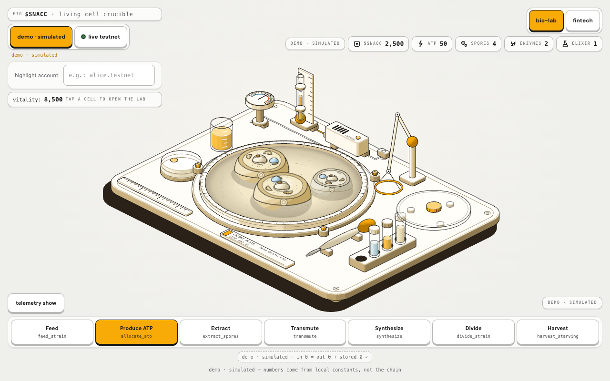
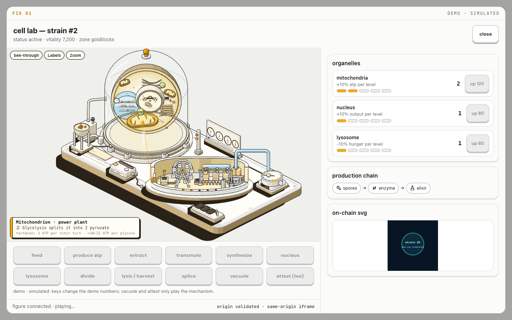
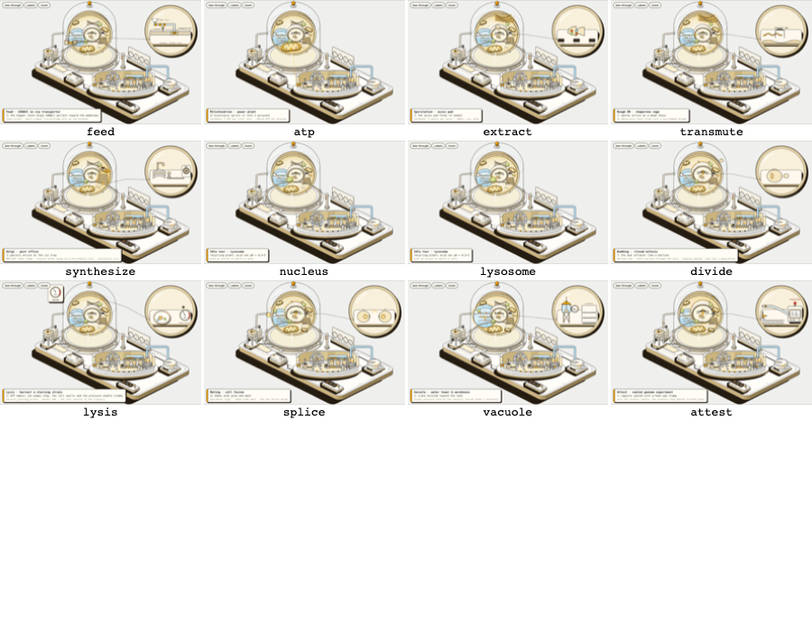

# SNACC frontend — cell-cultivation game UI

A cell-cultivation game for **Snacc ($SNACC)**: *NFTs that eat a memecoin.
Feed your Snacc or it gets snacked.* You tend living `Homunculus Strain`
cells on an isometric colony plate, open a chosen cell in its **Cell Lab**
bio-reactor, and watch the real cell-biology mechanism each lab action is
named after (a mitochondrion power plant, a Krebs wheel, an ATP-synthase
turbine). Every lab action is mapped to the exact contract method it stands
for — the map below. The Cell Lab keycaps themselves never submit a contract
call.

Production: **<https://snacc-nu.vercel.app>** (Vercel, built from `main`;
the game is at `/app`). Testnet only; `$SNACC` has no monetary value.

- **Demo mode** (`demo · simulated`, the default): the numbers come from local
  simulation constants, no wallet needed.
- **Live mode** (`live testnet`): every value comes from the backend API or from
  contract views on `snacc-v001.testnet`; missing values render as `—`. Without a
  wallet the Cell Lab keycaps are preview-only (`preview only — on-chain
  transactions need a wallet`).
- **With a NEAR testnet wallet connected** (NEAR Connect, or optional email or
  social login through Privy), live mode adds the signed game actions: hatch,
  feed, allocate ATP, divide, splice, extract / transmute / synthesize, buy
  spores, adopt / takeover / harvest, claim a dividend, redeem aether, gift a
  Snacc and send `$SNACC`. See [Wallet](#wallet-testnet).

**Status, stated plainly.**

- The wallet login and the signed actions are in the production build.
- The exact payloads of four of them (hatch, feed, allocate ATP, divide) were
  accepted by the contract on testnet. Those transactions were signed with the CLI
  using the payloads this UI builds, not through the UI's wallet flow; the umbrella
  README lists the hashes.
- A transaction signed through the UI's own wallet flow is not recorded yet. The
  payloads of the other actions have not been checked against the chain by this UI
  (the contract methods themselves are covered by the umbrella's gladi evidence,
  signed outside the UI).
- The profile features (Supabase) are built and merged but **not deployed yet**: the
  production build has no Supabase configuration, so they stay hidden. See
  [Player profiles](#player-profiles-optional-ui-148ui-149).

## Routes

There is no router library: `src/route.ts` picks one of these from the path, and each route is its own lazy
chunk (the landing page never downloads the game, the wallet connector or Privy). `vercel.json` rewrites every
path to `index.html`, so the 404 page is rendered by the app itself.

| Path | What it is |
| --- | --- |
| `/` | Landing page: scroll story through the incubator and a live testnet gallery |
| `/app` (and `/app/…`) | The game: Colony Plate arena, Cell Lab, HUD, wallet, signed actions |
| `/sign` | Signing page that the optional Privy email login opens in a popup (`src/sign/`); it only explains that email login is off when `VITE_PRIVY_APP_ID` is empty |
| `/terms`, `/privacy` | Static legal pages (`src/legal/`) |
| `/p/<account>` | Public player profile: the account's Snaccs from contract views, plus username, achievements, streak and follow when the profile database is configured |
| `/snacc/<id>` | Public Snacc page: on-chain SVG, owner, status, vitality, and "Open in game" (`/app?strain=<id>`) |
| anything else | 404 page |

`public/manifest.webmanifest` makes the game installable as a PWA (`start_url` `/app`).

## Screens

| Screen | What is on it |
| --- | --- |
| **Colony Plate arena** | An anatomy-style isometric SVG arena (the `Colony Plate`): yeast-like strain cells whose look encodes status and macro zone, a CrucibleTemp gauge, a nutrient-burst badge, and a keycap HUD dock. Tap a cell to open it. |
| **Microscope-iris transition** | A iris close/open visual transition between the arena and the Cell Lab, centred on the tapped cell. |
| **Cell Lab sheet** | The bio-reactor cutaway figure (`public/figures/cell-lab.html`, embedded with `?embed=1`) plus twelve keycap actions, organelle upgrade cards (mitochondria / nucleus / lysosome), the production chain (spores → enzyme → elixir), and the on-chain NFT SVG. |
| **HUD** | Mode switch (`demo · simulated` / `live testnet`), resource pills ($SNACC / ATP / spores / enzymes / elixir), vitality readout, thermal gauge, breach log, appetite panel, telemetry toggle. |

The Cell Lab figure is a teaching cutaway: a mitochondrion power plant with
a Krebs-cycle wheel, an electron-transport **cable car**, and an ATP
synthase **turbine** producing 3 ATP per rotor turn. Its twelve mechanism
animations are `feed`, `atp`, `extract`, `transmute`, `synthesize`,
`nucleus`, `lysosome`, `divide`, `lysis`, `splice`, `vacuole`, `attest`.








## Organelle → contract-method map

| Lab action | Contract method | Notes |
| --- | --- | --- |
| `feed` | `feed_strain` | feeds $SNACC to the strain |
| `atp` | `allocate_atp` | organelle slots: `mitokondria`, `nukleus`, `lisosom` — level 0–5 each; `mitokondria` +10% ATP per level, `nukleus` +10% output per level, `lisosom` −10% hunger per level |
| `extract` | `extract_spores` | harvest spores from the strain |
| `transmute` | `transmute_spores_to_enzyme` | spores → enzyme |
| `synthesize` | `synthesize_elixir` | enzyme → elixir |
| `divide` | `divide_strain` | mitosis: one strain becomes two (colony growth) |
| `lysis` | `harvest_starving_strain` | harvest a fainted strain; releases a Nutrient Burst |
| `splice` | `splice_strains` / `hostile_takeover_splice` | merge two strains, or take over a distressed one |
| `vacuole` | — (mechanism play only) | plays the vacuole pulse animation; changes no numbers |
| `attest` | `commit_genome_experiment` → `apply_tee_mutation_zero_trust` | genome experiment committed off-chain in NEAR AI Cloud TEE, then applied on-chain after the ed25519 check |

This map names what each keycap stands for. The keycaps play the mechanism (and change numbers only in demo
mode); the signed calls live in the dock and the **Game actions** window, see [Wallet](#wallet-testnet). The
`attest` flow (`commit_genome_experiment` → `apply_tee_mutation_zero_trust`) has no signed action in this UI.

## Demo vs live honesty

- **Demo** (`demo · simulated`): the arena seeds a simulated colony around a
  600–610 mK balance band; every keycap changes the local simulation numbers
  (ATP, vitality, spores, and so on). The footer reads `demo · simulated —
  numbers come from local constants, not the chain`, and the production
  receipt shows what went `in · out · stored`. `vacuole` and `attest` only
  play the mechanism and change no numbers even in demo.
- **Live** (`live testnet`): data comes only from the backend API
  (`/api/crucible/macro`, `/api/strains`, `/api/events`, `/api/appetite`).
  When the API returns nothing, the UI shows `—` placeholders — it never
  fabricates a value. The Cell Lab keycaps are always preview-only in live
  mode: pressing one shows `preview only — on-chain transactions need a
  wallet`. Signed transactions come only from the dock and the Game actions
  window, and only with a connected wallet. The header status reads
  `live · testnet reads only` without a wallet and `live · testnet · wallet
  connected` with one.

## postMessage bridge contract

The app embeds the Cell Lab figure as an iframe at
`/figures/cell-lab.html?embed=1` and talks to it over `postMessage`. All
inbound messages are validated for exact origin and exact shape; anything
else is ignored, never executed. Implementation: `src/game/bridge.ts`.

App → figure:

```ts
{ type: "snacc:state", strain: {
    strain_id: number, status: string,
    vitality: number, effective_vitality: number,
    atp_balance: string,
    organel: { mitokondria: number, nukleus: number, lisosom: number },
    generation: number, role_mask: number,
  }, zone: string }
{ type: "snacc:play", action: "feed" | "atp" | "extract" | "transmute" |
    "synthesize" | "nucleus" | "lysosome" | "divide" | "lysis" |
    "splice" | "vacuole" | "attest" }
```

Figure → app:

```ts
{ type: "snacc:ready" }
{ type: "snacc:action", action: LabAction }   // figure-initiated run
{ type: "snacc:done",  action: LabAction }   // animation finished, keys unlock
```

Notes:

- The app sends `snacc:state` only when it changes, and always re-sends
  right after `snacc:ready` (the figure may finish loading after the first
  post). The organelle levels in the message are the same values the side
  panel renders (`resolveOrganelLevels` in `src/game/labState.ts`).
- The figure plays one animation at a time; while one runs, every keycap is
  disabled. A 10 s fallback timeout unlocks the keys if the figure never
  answers `snacc:done`.
- The iframe colour scheme is mirrored from the figure document so the
  transparent embed stays transparent over the cream card.

## Run locally

Node.js 20 or newer (`engines` in `package.json`).

```bash
cd frontend
cp .env.example .env.local     # every variable is optional, see the table below
npm ci
npm run dev                    # http://localhost:5173, proxies /api to http://localhost:8787
```

- `npm run dev` — dev server (port 5173; `/api` is proxied to a local backend on port 8787).
  `npm run build` — production build (`tsc --noEmit && vite build`). `npm run preview` —
  preview the build on port 4173. `npm test` — the test suite (see [Tests](#tests)).
- Open `/` for the landing page and `/app` for the game. With nothing configured the game runs in
  `demo · simulated` mode.
- A wallet works against `testnet` only. A new testnet account needs NEAR from the
  [faucet](https://docs.near.org/tools/faucet); the app links to it when the balance is low.

The production deployment at <https://snacc-nu.vercel.app> is the same build with the variables set
on Vercel. Screenshots under [`docs/img/`](docs/img/) were taken from a production build served
locally on a static gzip server.

## Environment variables

All are build-time `VITE_*` values, read once. All are optional; each feature turns itself off when
its variable is empty. Only public values go here: no secret belongs in a `VITE_*` variable, and the
file with real values (`.env.local`) is not committed.

| Variable | Used for | When empty |
| --- | --- | --- |
| `VITE_API_BASE` | Base URL of the Snacc backend API (`/api/crucible/macro`, `/api/strains`, `/api/events`, `/api/appetite`) | Live mode has no API and the game runs on built-in demo data only |
| `VITE_PRIVY_APP_ID` | Privy App ID (public, from the Privy dashboard). Adds "Email or social login (Privy)" to the wallet picker | Email or social login is off; the picker lists the normal NEAR wallets only |
| `VITE_PRIVY_CLIENT_ID` | Optional Privy client id | Not passed to Privy |
| `VITE_SUPABASE_URL` | Supabase project URL for the optional player profiles | Profile features hidden (needs both Supabase variables) |
| `VITE_SUPABASE_PUBLISHABLE_KEY` | The project's publishable key (public by design; row-level security guards the data) | Profile features hidden (needs both Supabase variables) |
| `VITE_REF_INDEXER_URL` | Rhea price list base URL for the swap quote window (default `https://api.rhea.finance`) | Default |
| `VITE_INTENTS_API_URL` | NEAR Intents 1Click API base URL (default `https://1click.chaindefuser.com`) | Default |
| `VITE_SNACC_TOKEN_ID` | A mainnet `$SNACC` token id, if one ever exists; unset today | `$SNACC` is not priced or quoted (it is a testnet token) |

`.env.example` documents the same set. Without both Supabase variables, `src/account/` never loads
`@supabase/supabase-js`.

## Source layout

| Folder | What lives there |
| --- | --- |
| `src/chain/` | Everything that touches the wallet and signed transactions, see [Wallet](#wallet-testnet): `wallet.tsx` (NEAR Connect provider and `useWallet()`), `actions.ts` (the call builders and their guards), `txResult.ts` (wallet outcome and contract panic text, to plain English), `privy.ts` (optional Privy entry for the picker), `accountViews.ts` and `useAccountInfo.ts` (NEAR and `$SNACC` balance, NEP-145 registration, owned strains), `gameViews.ts` (the views the action windows need) |
| `src/account/` | Optional player profiles on Supabase, see [Player profiles](#player-profiles-optional-ui-148ui-149): `config.ts` (the env gate, pure), `signIn.ts` (NEP-413 sign-in), `session.tsx` (provider and `useAccount()`), `api.ts` and `model.ts` (reads, writes, `record-tx`, starter pack), `notifications.tsx`, `client.ts` (lazy Supabase client) |
| `src/help/` | First-run intro (`OnboardingModal`), the Help window with rules, glossary and costs (`HelpModal`), Settings (`SettingsModal`), `content.ts` (the copy; numbers come from code constants) |
| `src/legal/` | `/terms`, `/privacy` and the 404 page (`StaticPage.tsx`, `content.ts`) |
| `src/public/` | `/p/<account>` and `/snacc/<id>` |
| `src/sign/` | The `/sign` page for the optional Privy login |
| `src/prefs/` | Local preferences (sound, reduce motion) and the "Reset local data" key list |
| `src/data/` | Reads: backend API client, contract views over public RPCs, collection, NPC quotes, the poller |
| `src/hud/`, `src/plate/`, `src/game/` | The game UI, the isometric Colony Plate, and the demo simulation plus the Cell Lab postMessage bridge |
| `src/landing/` | The landing page |
| `src/swap/`, `src/recipes/` | The swap quote window and the local recipe search |
| `src/ui/` | Shared window, keycap and dialog primitives |

## Tool windows

One toolbar under the plate opens six windows (below 900 px they fold into a
**tools** sheet). They share the landing's look (`src/ui/`: square 1 px ink
windows, dithered shadows, line icons) and behave as modal dialogs: Escape and
a backdrop click close them, Tab stays inside, focus returns to the opener,
and under 640 px they open as bottom sheets. Each loads on first open.

| Window | What it shows | Data source |
|---|---|---|
| NPC merchants (ADR-30) | The three contract NPCs, their stock and a spore quote with the contract's `reasoning_tooltip` | **live:** views `get_npc`, `npc_quote_spores` on `snacc-v001.testnet`; this window only quotes, buying is the signed `npc_buy_spores` in the Game actions window (see [Wallet](#wallet-testnet)). **demo:** the same rule on genesis state, every number labelled SIMULATION |
| Swap quote | Rhea reference price and a NEAR Intents 1Click **dry** quote between listed assets | public APIs in both modes (`api.rhea.finance/list-token-price`, `POST 1click.chaindefuser.com/v0/quote` with `dry: true`, no API key). `$SNACC` is a testnet token and is listed on neither |
| Great Feast | Epoch, zone, feast volume and the top-3 feeders, plus a near.social markdown post to copy | **live:** backend `/api/appetite`, else views `get_appetite_meter` + `get_top_feeder`; empty state when both are empty. **demo:** invented feeders, labelled SIMULATION |
| Thesis | Four numbers from the testnet rehearsal of 2026-11-09, each linked to its tx (or named view); live mode adds a fresh view read. SQL **query templates — not executed** (Snacc is testnet-only) | `src/data/evidence.ts` (copied from the umbrella repo's evidence pack), views `get_macro_state`, `get_global_solvency`, `get_crucible_temp` |
| Recipes | **Local recipe search (keyword)** over the recipes the contract implements, with each method's real signature and a JSON call template to copy | in-browser word match; no model, no network |
| Guest label | **Guest label — local only, no on-chain account, nothing is signed.** A valid `.testnet` account, if typed, only highlights its strains. near.email and Auth0 are shown as disabled "planned" options | `localStorage` (label and optional account only) |

Amounts are `$SNACC` with 24 decimals. Nothing in these six windows signs a
transaction, and nothing feeds a game mechanic. The signed game actions are a
separate window set, see [Wallet](#wallet-testnet). Configuration of the swap
window is in [Environment variables](#environment-variables).

## Player profiles (optional, UI-148/UI-149)

**Status: built and merged, not deployed yet.** These features need a Supabase project with the
schema and Edge Functions from the backend repo (`supabase/`, see its README). That database setup
has not been deployed, and the production build has no `VITE_SUPABASE_URL` /
`VITE_SUPABASE_PUBLISHABLE_KEY`, so everything in this section is hidden there today. It is enabled
by setting both variables once the database is deployed; until then nothing here is live.

With both variables set, the game shows "Save progress — sign in" next to the wallet, the Profile
window, the notifications bell, usernames and extra leaderboard tabs ("Most active (7 days)",
"Longest streaks", "Following"), the starter-pack key and the profile parts of `/p/<account>`. With
either variable empty all of it stays hidden and the game is unchanged.

`src/account/` signs in with NEAR through the backend repo's Edge Functions: `near-auth/challenge`
issues a NEP-413 message, the wallet signs it (`signMessage`, no transaction), `near-auth/verify`
checks it and returns a token for `supabase.auth.verifyOtp`. A limited (function-call) key is refused
with a plain message. Sign-out clears only the profile session; a session for another account than
the connected wallet is dropped. `@supabase/supabase-js` is in its own lazy chunk: the landing page
never loads it, and `/app` loads it only after a wallet is connected or a stored session exists.
After each successful signed action the app calls `record-tx` (fire and forget) and toasts new
achievements; the optional starter pack calls `starter-pack` (testnet NEAR for a low wallet).
Public pages: `/p/<accountId>`
(profile, Snaccs from contract views, achievements, streak, follow) and `/snacc/<id>` (on-chain SVG,
owner, status, vitality, "Open in game" = `/app?strain=<id>`).

## Wallet (testnet)

The header has a **connect wallet** key (`src/chain/wallet.tsx`, [NEAR Connect](https://github.com/hot-dao/near-selector),
network `testnet`). The connector loads on demand, so the landing page never downloads it. Wallets
run in NEAR Connect's sandboxed iframes and sign there; the app never sees or stores a key. Once
connected, the header shows the account, its spendable testnet NEAR and its `$SNACC`
(`ft_balance_of`; testnet, no monetary value), and the wallet account becomes the highlighted
account and the My collection account.

### Signed actions

In live mode with a connected wallet, the dock keys **Hatch**, **Feed**, **Allocate ATP**, **Extract**,
**Transmute**, **Synthesize**, **Divide** and **Harvest** open a signing window, and the **Actions**
key opens the full list. Every window is built the same way: a pure builder in `src/chain/actions.ts`
(method name, arguments, prepaid gas and attached NEAR, mirroring the deposit rules of
`sdk/src/client.ts`) → a window that reads the views it needs and checks the contract's guards before
enabling the sign key → the wallet → the result. All calls go to `snacc-v001.testnet`.

| Action (window) | Contract method | Attached NEAR |
|---|---|---|
| Hatch | `incubate_strain(role, initial_snacc_stake, initial_spores)` | the stake (default 0.25 NEAR) |
| Feed | `feed_strain(strain_id, amount)` on an owned strain | none |
| Allocate ATP | `allocate_atp(strain_id, mitokondria, nukleus, lisosom)` | none |
| Divide | `divide_strain(strain_id)` | none |
| Splice | `splice_strains(dominant_id, absorbed_id)` | none |
| Extract / Transmute / Synthesize | `extract_spores`, `transmute_spores_to_enzyme`, `synthesize_elixir` | the catalyst fee (`snacc_catalyst_fee`; transmute after the diet discount) |
| Buy spores | `npc_buy_spores(strain_id, npc_id, buy_amount)` | none (paid from the strain's `$SNACC`) |
| Hungry strains | `adopt`, `hostile_takeover_splice`, `harvest_starving_strain` | none |
| Industrial pool | `synthesize_and_redeem_aether`, `claim_industrial_dividend` | none |
| Give a Snacc | `nft_transfer(receiver_id, token_id, memo)` | 1 yoctoNEAR |
| Send `$SNACC` | `ft_transfer(receiver_id, amount, memo)` | 1 yoctoNEAR |
| First signed call only | `storage_deposit(account_id, registration_only: true)`, added automatically to the first transaction when the account is not registered | `storage_balance_bounds().min` |

Each window shows the cost before signing and then the result in the tx status panel: the tx hash
with a nearblocks link, or the contract error in plain English with the raw text underneath. A
faucet link ([docs.near.org/tools/faucet](https://docs.near.org/tools/faucet)) appears when the
account lacks testnet NEAR. Without a wallet the windows still show their live reads and a connect
button; nothing is signed. Demo mode keeps the simulated dock.

With `VITE_PRIVY_APP_ID` set, "Email or social login (Privy)" appears in the same picker (via
`@peerfolio/privy-near-connect`); its signing popup is the `/sign` route, a separate chunk. A Privy
account is new and starts with 0 NEAR. The production build has this variable set; the full path
from email login to a signed game transaction has not been recorded on chain yet.

**What has been proven on chain.** The payloads that `buildIncubate`, `buildFeed`, `buildAllocateAtp`
and `buildDivide` produce were sent to the contract and accepted. Those four transactions were signed
with the CLI, not through this UI's wallet flow (hashes in the umbrella README's "On-chain proof"
table). The UI wallet flow itself has not been exercised on chain yet, and no on-chain claim is made
for the other builders. The builders' arguments are unit-tested (`npm test`).

`index.html` carries the CSP the wallets need: a fixed nonce for NEAR Connect's `srcdoc` wallet
frames (`script-src … 'nonce-…'`, same value as `NEAR_CONNECT_CSP_NONCE`) and `https:` for wallet
icons, styles, fonts and frames.

## Tests

```bash
npm test
```

Vitest in a node environment (no DOM, no network): at commit `264320b`, `npm ci && npx vitest run`
passes 391 tests in 35 files; run it for the current count, and `npm run build` for the type check.
The suite covers bridge message validation, keycap busy state, live placeholders (`—` vs fabricated
values), simulation, poller, optimistic vitality, zones, isometric plate geometry, routing
(`src/route.ts`), the Rhea price client, the 1Click dry-quote request and response handling, the NPC
quote rule against a real contract response, the tool windows' dialog semantics and keyboard logic,
the transaction builders and their guards, wallet and Privy configuration, the tx result and error
text, the first-run intro, Help, Settings and legal copy, the profile modules (`src/account/`), the
public-route parsing, and word guards over all of `src`. Because there is no DOM, Escape, focus trap and
focus return are covered through the shared keyboard logic (`src/ui/a11y.ts`) and checked by hand in
a browser. The wallet popups, Privy login and Supabase are not exercised by tests: they need real
services.

## Lighthouse (static gzip server, production build)

| | Performance | Accessibility | Best practices | SEO |
| --- | --- | --- | --- | --- |
| Desktop | 100 | 100 | 100 | 100 |
| Mobile | 99 | 100 | 96 | 100 |

Measured on a static gzip server over the production build
(`npm run build` output). This section was written on 2026-11-09, before the landing page, wallet and
profile work, and the audit was not re-run for this update.

## Credits

The isometric plate and figure rendering use the **Anatomy** kit by
**April Zhu**, MIT-licensed. The kit sources are copied into
`src/plate/iso/` with a provenance note in
`src/plate/iso/LICENSE-anatomy-kit`.
